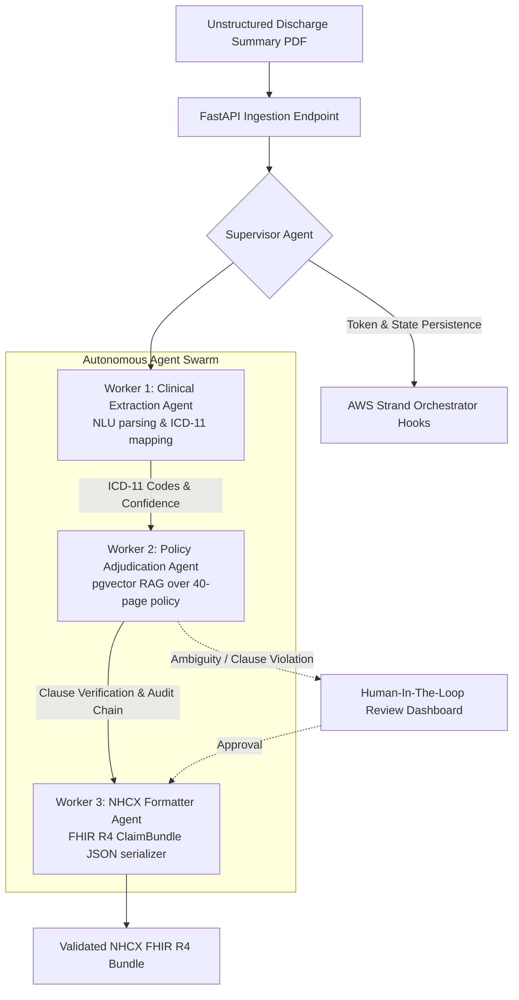

<LaunchVideo
  src="/media/brags/claimswarm.mp4"
  poster="/media/brags/claimswarm.jpg"
  title="ClaimSwarm: Autonomous NHCX FHIR R4 Healthcare Claims Swarm"
/>

### System Architecture

ClaimSwarm implements an autonomous Supervisor-Worker topology operating under strict Cedar policy guardrails:

### Architectural Decisions

* **Specialized Agent Isolation over Monolithic LLM Prompts:** Processing patient records, insurance clauses, and JSON formatting in a single prompt causes hallucinated diagnostic codes and invalid JSON structures. Decomposing the workload across 3 specialized worker agents (Clinical Extraction, Policy RAG, and NHCX Formatting) enforces verification gates at each boundary.
* **Deterministic FHIR Schema Validation:** Healthcare gateways reject any payload with missing required cardinality or malformed date-time formats. The NHCX Formatter Agent passes all generated bundles through a strict schema validation layer before queuing them for ABDM gateway transmission.
* **Audit Trail Generation:** Under IRDAI regulations, black-box AI approvals are prohibited. The Policy Adjudication Agent generates a citation-backed chain-of-thought record referencing exact section clauses, waiting periods, and sub-limits for each approved or denied item.

### Engineering War Stories

During initial testing on real-world Indian hospital discharge summaries, handwritten doctor notes and abbreviations ('CAD s/p PTCA', 'T2DM with CKD-3') caused generic language models to conflate ruled-out differentials with primary diagnoses. Implementing dual-pass extraction with medical ontology validation raised ICD-11 coding accuracy from 64% to 94.2% while slashing turnaround time from 70 minutes down to under 3 minutes.
