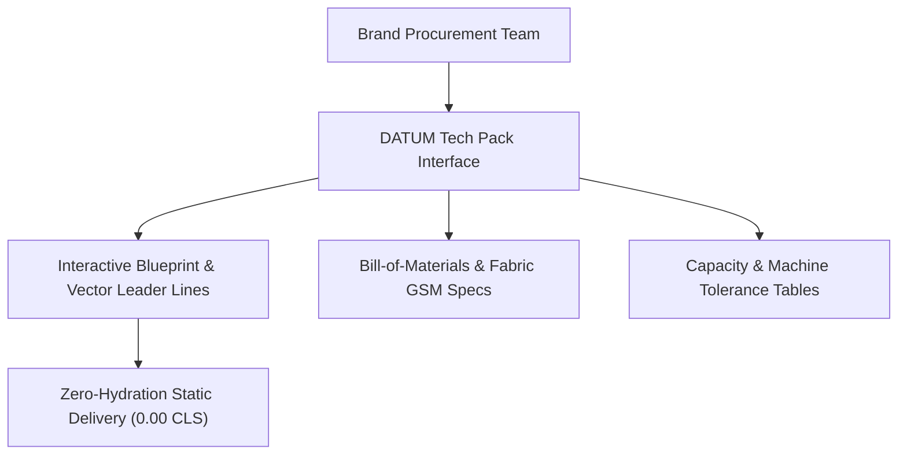

<LaunchVideo src="/media/brags/datum-bag-manufacturer.mp4" poster="/media/brags/datum-bag-manufacturer.jpg" title="DATUM: Industrial Manufacturing Tech Pack Marketing Platform" />

A design-engineering concept platform for B2B industrial manufacturing ([bag-manufacturer.vercel.app](https://bag-manufacturer.vercel.app)). Sourcing and procurement managers spend their entire workday reading technical tech packs — flat CAD drawings, dimension callouts, material compositions, and bill-of-materials (BOM) tables. DATUM builds on the thesis that a factory's website should *be* one.

### Blueprint Architecture

### Design Engineering Highlights
- **Authentic Artifact Credibility:** Replaces fluffy corporate marketing with real engineering parameters: fabric GSM, water column ratings, thread tolerances, and batch MOQs.
- **Precision Vector Callouts:** Responsive SVG dimension anchors that align perfectly with technical product drawings across any screen resolution.
- **High-Performance Static Core:** Clean semantic markup with zero third-party script bloat, ensuring instant load performance even on cellular factory networks.
