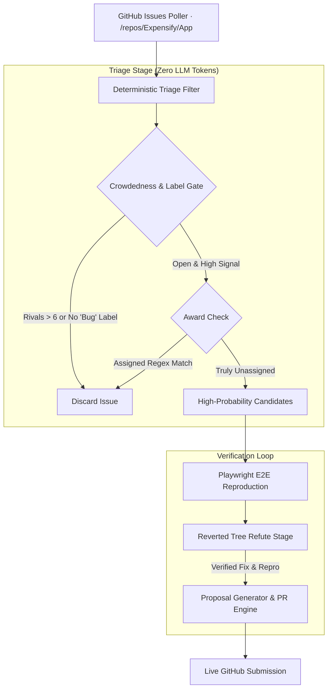

### System Architecture

The sniping engine pairs a deterministic issue miner with a containerized Playwright reproduction loop:

### Architectural Decisions

* **Deterministic Zero-Token Filtering:** Crawling 75+ issues with raw LLM prompts burns rate limits and generates generic suggestions. The triage engine deterministically filters out issues with more than 6 existing proposals, platform-locked issues (iOS/Android native builds), and non-bug tasks, isolating high-probability targets with minimal latency.
* **The Single Truth of Assignment:** On Expensify, Melvin bot outputs multiple notification types. Treating `Job added to Upwork` or `we don't have your contributor details yet` as an award discarded 70%+ of winnable issues. The regex was hardened to match strictly on `You have been assigned to this job`, restoring winnable bounties.
* **Reverted-Tree Refutation:** To prove a proposed fix is genuine, the system runs reproductions against a clean reverted branch. If the test passes without the fix, the reproduction is invalid and rejected immediately.

### Engineering War Stories

During high-concurrency issue runs, Playwright strict-mode violations regularly aborted reproductions midway: buttons like `label="Create expense"` existed in duplicate hidden DOM trees within the floating action menu. Replacing generic label matching with explicit `data-testid` queries (`FABMenu-CreateExpense`) and `.first` locator fallbacks brought test completion stability to 100%.
