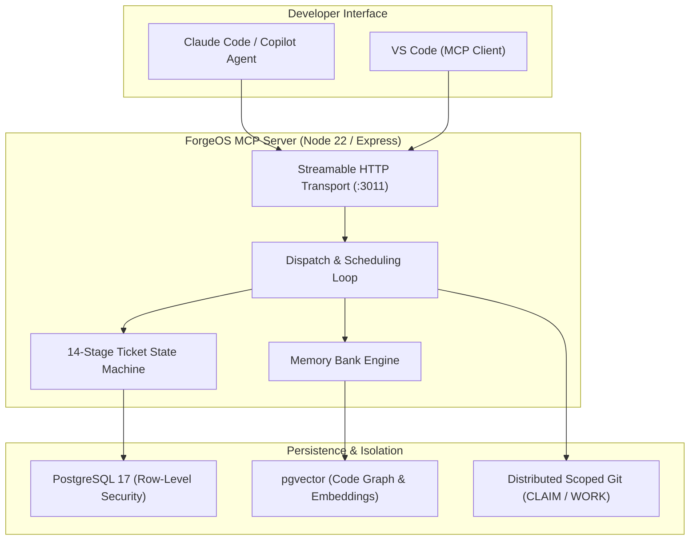

ForgeOS is an adaptive, event-driven multi-worker orchestration system that simulates a professional engineering organization rather than generating naive code snippets. It bridges the gap between individual AI code suggestions and end-to-end production engineering delivery.

The system decomposes incoming project visions into tickets, manages cross-ticket dependencies via a directed acyclic graph (DAG), allocates specialized workers from dynamic pools, and enforces strict governance gates.

### System Architecture

### Engineering War Story: Conflict-Free Concurrency Under Multi-Worker Fleets

**The Problem:** In multi-worker concurrent agent runs, workers attempting to claim tickets frequently caused race conditions, double-claiming, and uncommitted git workspace collisions.

**The Fix:** Engineered atomic ticket claiming via PostgreSQL row-level locks (`SELECT FOR UPDATE SKIP LOCKED`) coupled with a distributed two-commit protocol (`CLAIM` commits the reservation state; `WORK` commits the isolated scoped diff). This guaranteed that no two agents could modify overlapping dependency trees simultaneously.
