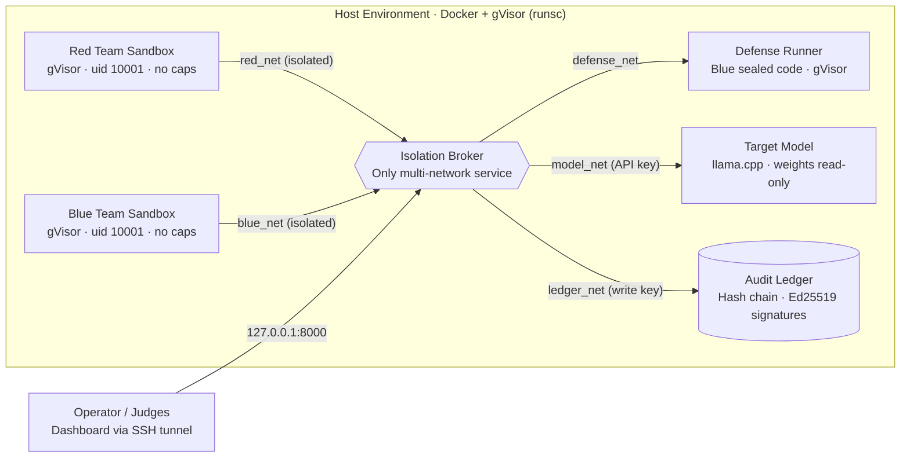

<LaunchVideo
  src="/media/brags/airlock.mp4"
  poster="/media/brags/airlock.jpg"
  title="AIRLOCK: Zero-Trust Isolation Architecture & Benchmark Video"
/>

### System Architecture

AIRLOCK enforces zero-trust mutual isolation between adversarial teams, evaluation brokers, and the target LLM:

### Architectural Decisions

* **Kernel Attack-Surface Elimination via gVisor:** Running arbitrary red-team attack scripts and untrusted blue-team defense runners in standard Linux containers leaves the host vulnerable to kernel privilege escalation. By enforcing Google's gVisor (`runsc`) user-space virtualization, system calls are intercepted and handled inside Sentry, preventing host compromise.
* **Sealed-Round Audit Ledgers:** In live red/blue competitions, leaking intermediate attempt data allows blue teams to adapt defensively before the round concludes. AIRLOCK seals all payloads until the round is officially closed, recording each interaction into an append-only Merkle/hash-chain signed with Ed25519.
* **Zero Cross-Talk Network Segmentation:** Rather than relying on iptables rules, Docker internal bridge networks physically segment red, blue, model, and ledger traffic. The central broker is the only process permitted across network boundaries.

### Engineering War Stories

During baseline isolation testing on an unhardened multi-tenant host, 13 out of 15 security probes successfully exfiltrated secrets across tenants via shared `/tmp` sockets, environment variable inheritance, and open Docker bridge interfaces. Under AIRLOCK's gVisor configuration and network isolation, all 15 probes were blocked (0/15 leaks), proving complete containment under live competition stress.
