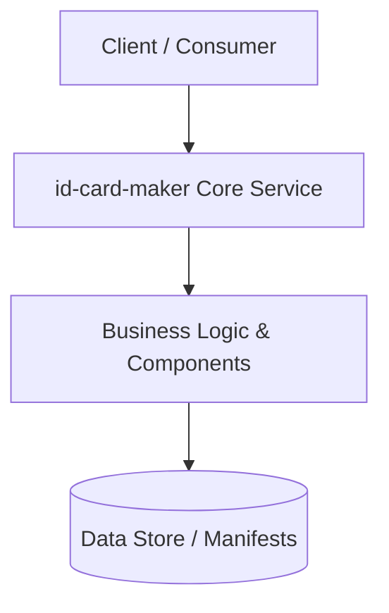

A high-precision desktop layout and print-imposition tool engineered for generating batches of institutional ID cards. Designed to handle noisy inputs, misaligned templates, and variable-length text without manual graphic design adjustments.

### System Architecture

### Engineering Challenges Solved

- **Deterministic Preflight:** Automatically flags undersized photos, missing student identifiers, and template drift before triggering expensive print runs.
- **Dynamic Text Fitting:** Computes bounding boxes mathematically to ensure multi-line names and designations fit strict badge boundaries without clipping.
