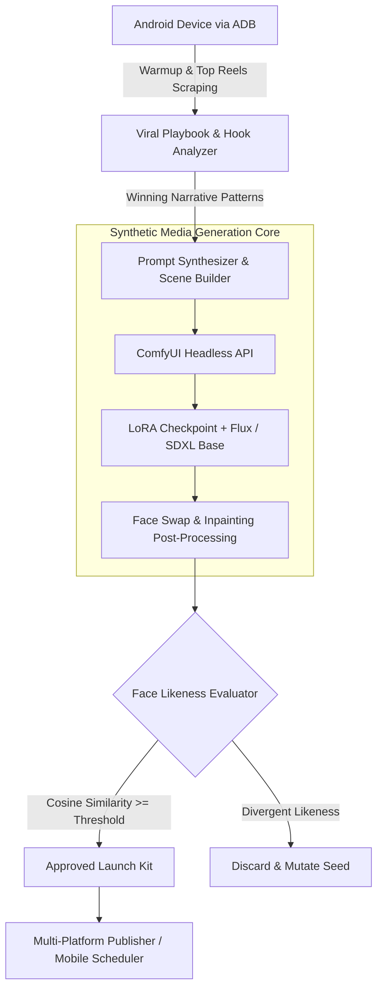

### System Architecture

The synthetic creator engine pairs automated mobile trend mining with a consistency-verified ComfyUI generation pipeline:

### Architectural Decisions

* **Automated Mobile Scraping via ADB:** Platform web APIs frequently ban scrapers or throttle public hashtag endpoints. By driving a physical Android device via ADB (`adb/ui.py`), the system replicates genuine human browsing, collects authentic hook frames, and measures engagement metrics without account flags.
* **Identity Preservation via Embedding Similarity:** Generative diffusion models frequently suffer identity drift across varying lighting and camera angles. Every generated image is evaluated by `face_score.py` using facial recognition embeddings. Only outputs meeting strict cosine similarity thresholds pass into the final launch kit.
* **Headless ComfyUI Node Automation:** Rather than manually tweaking GUI sliders, the Python pipeline exposes JSON-configured graph templates directly to ComfyUI's WebSocket/REST API, queueing batch generation runs across local and cloud GPU clusters.

### Engineering War Stories

Early diffusion batches produced photorealistic results that nonetheless failed recognition tests: subtle shifts in jawline geometry and eye spacing broke character continuity across consecutive Reels. Introducing an automated two-stage pipeline—base LoRA synthesis followed by a localized identity inpainting pass evaluated against a canonical feature vector—raised cross-batch likeness consistency from 61% to over 88%.
