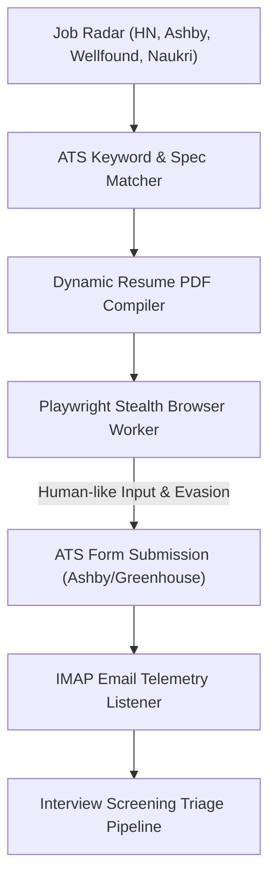

<LaunchVideo src="/media/brags/job-hunt.mp4" poster="/media/brags/job-hunt.jpg" title="Autonomous Career Pipeline Engine: Multi-Portal Stealth Job Automation" />

An autonomous job application and sourcing engine engineered to eliminate repetitive application overhead across modern applicant tracking systems (ATS). The system combines headless stealth automation, contextual resume tailoring, and automated email pipeline intelligence.

### Automation Flow Architecture

### Core Features
- **Stealth Evasion:** Configured with randomized TLS fingerprints, realistic interaction pauses, and headless evasion plugins to reliably navigate ATS portals.
- **Dynamic PDF Compilation:** Matches job descriptions against verified project experiences, generating tailored single-page resumes on demand.
- **Telemetry Radar:** Continuously parses inbound recruiter emails, sorting confirmations, interview invites, and rejections into an actionable triage database.
