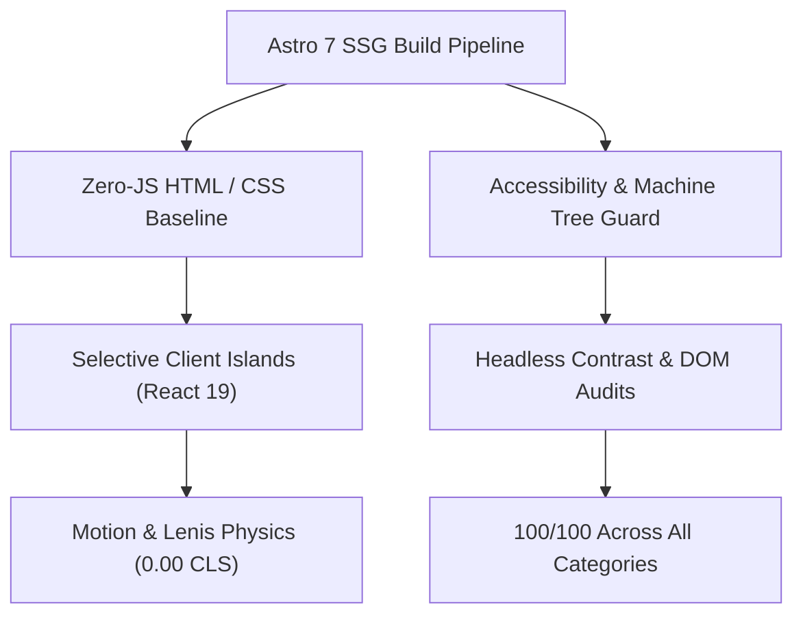

<LaunchVideo src="/media/brags/ofc-redesign.mp4" poster="/media/brags/ofc-redesign.jpg" title="Overseas Food Consultants: High-Performance B2B Redesign" />

An architectural and visual concept redesign of Overseas Food Consultants ([ofc.org.in](https://www.ofc.org.in/)). Traditional B2B enterprise websites often suffer from broken contrast, disoriented heading orders, and poor machine readability. This rebuild proves that rich kinetic interactions, modern aesthetics, and audit-grade accessibility can coexist seamlessly.

### System Architecture

### Measured Production Results
Audited against production previews on mobile viewport:
- **Accessibility:** 100 / 100 (Fixed color-contrast, heading hierarchy, and ARIA roles)
- **Agentic Browsing:** 100 / 100 (Structured semantic landmarks and machine-parsable microdata)
- **Cumulative Layout Shift:** 0.00 (Zero layout drift during fonts/assets load)
- **Best Practices & SEO:** 100 / 100
