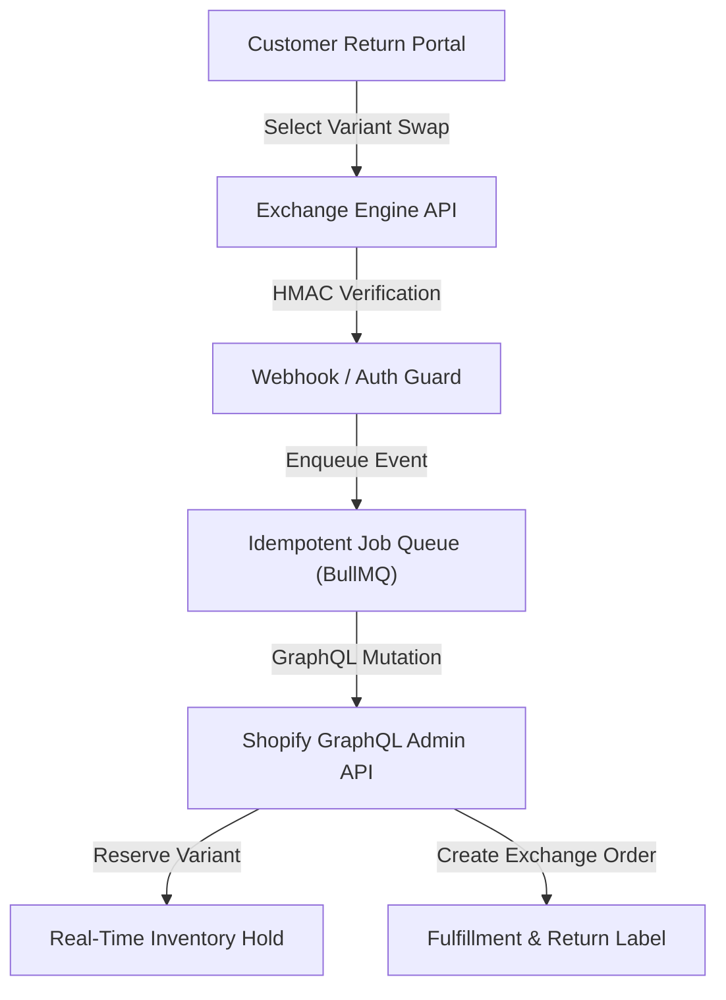

<LaunchVideo src="/media/brags/shopify-apps.mp4" poster="/media/brags/shopify-apps.jpg" title="Shopify Exchange Engine: Zero-Friction Automated eCommerce Returns" />

An enterprise-ready Shopify application engineered to automate return-to-exchange flows. Instead of losing revenue to manual refunds and support ticket backlogs, the engine turns return requests into instant product variant swaps while synchronizing inventory in real time.

### System Architecture

### Technical Highlights
- **Cryptographic Security:** Every incoming webhook payload is verified with HMAC SHA-256 before ingestion, preventing spoofed return signals.
- **GraphQL API Efficiency:** Leverages Shopify's GraphQL Admin API for atomic mutation batching, reducing network overhead compared to legacy REST endpoints.
- **Zero-Friction UX:** Direct integration with merchant store themes giving shoppers immediate variant selection, automated size recommendations, and instant exchange label creation.
