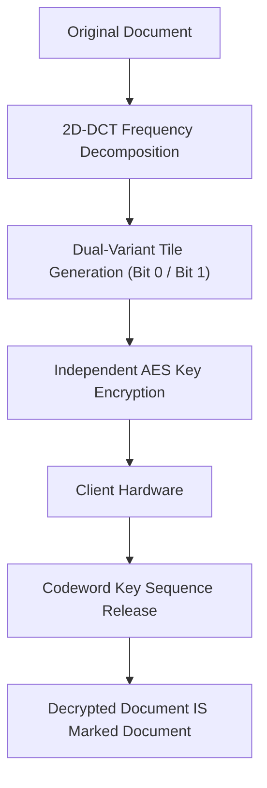

<LaunchVideo src="/media/brags/sih-2026.mp4" poster="/media/brags/sih-2026.jpg" title="SIH 2026: Zero-Plaintext Forensic Watermarking & Cryptographic Provenance" />

A high-assurance digital provenance and forensic document tracking system engineered for Smart India Hackathon (SIH 2026). Traditional watermarking leaves clean, unwatermarked plaintext buffers in client memory prior to rasterization. This engine eliminates that vulnerability by pre-encrypting dual-variant document tiles, guaranteeing that client decryption yields only watermarked outputs.

### Cryptographic Architecture

### Forensic Defense Capabilities

- **Zero-Plaintext Guarantee:** Decryption occurs per-tile according to the recipient's assigned codeword. Clean plaintext never touches client RAM or framebuffers.
- **Collusion Resistance:** Even if multiple recipients merge or average documents to wash out watermark bits, the Tardos score detector reliably isolates each conspirator's identity.
