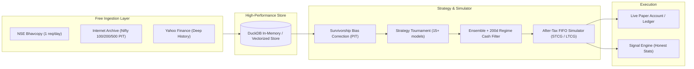

<LaunchVideo src="/media/brags/survivorship-free-backtester.mp4" poster="/media/brags/survivorship-free-backtester.jpg" title="Survivorship-Free Backtester: Honest Quantitative Trading Engine" />

Most retail backtests quietly lie: they test the past using today's winning stocks (survivorship bias), assume fractional shares that do not exist, and ignore tax friction. This engine was built to deliver the honest version using free data sources.

### System Architecture

### Core Empirical Findings

- **Survivorship Bias Impact:** Testing against surviving stocks artificially inflates momentum strategies by +0.4 to +0.9 Sharpe ratio.
- **Factor Exposure:** Intraday dip-buying strategies failed completely once real market microstructure and taxes were incorporated.
- **The True Winner:** An ensemble strategy switching to cash when the index falls below the 200-day moving average offered the best risk-adjusted profile.
