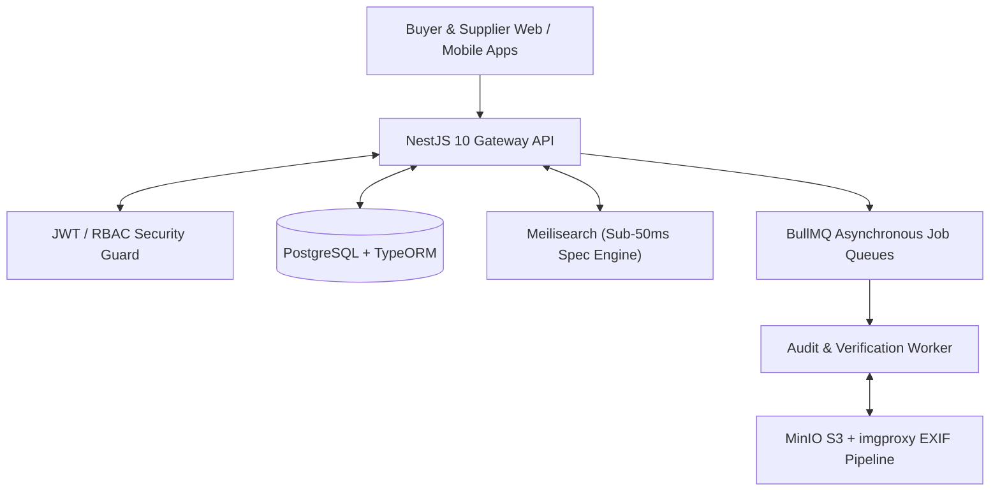

<LaunchVideo src="/media/brags/vmn.mp4" poster="/media/brags/vmn.jpg" title="Verified Manufacturing Network: SaaS Trust Infrastructure for Indian Industry" />

A SaaS-enabled manufacturing trust infrastructure engineered for Indian industry. VMN acts as a programmatic "Bureau of Standards", validating supplier identity, physical plant machinery, and verified production capacity so global procurement teams can underwrite manufacturers with audit-grade confidence.

### Monorepo & Service Architecture

### Core Innovations
- **Audit-Grade Verification:** Moves beyond paper self-declarations by cross-referencing GST filings, geotagged machinery photographs, and empirical power consumption logs.
- **Sub-50ms Search Latency:** Meilisearch cluster indexing machine parameters (bed size, spindle RPM, CNC axis limits) enabling instant matching for RFQs.
- **Multi-Tenant Monorepo:** Clean architectural separation across `@vmn/api`, `@vmn/mobile`, and shared UI packages managed with Turborepo and strict TypeScript contracts.
